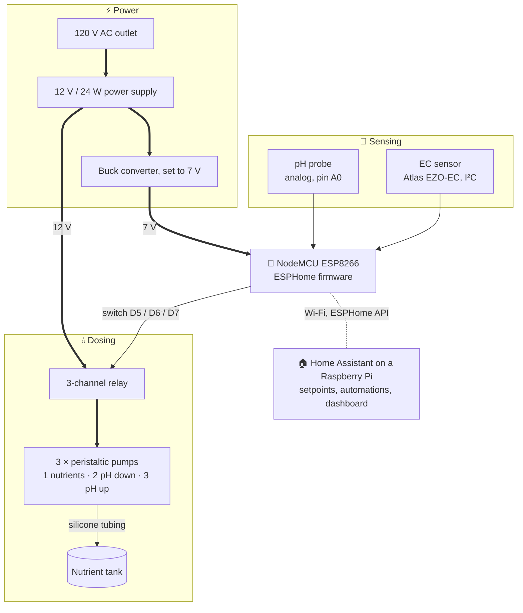

# Chaac

**Open-source pH & EC monitoring and automatic dosing for hydroponics**
(ESP8266 + ESPHome + Home Assistant)

> Named after Chaac, the Maya god of rain.

## What it does

Chaac measures the pH and electrical conductivity (EC) of a hydroponic nutrient solution and automatically doses corrective liquids with peristaltic pumps:

- **pH down / pH up**: keeps pH in the target range
- **Nutrient concentrate**: keeps EC above the target
- **Dashboard and notifications**: live gauges, 12 h graphs, adjustable setpoints and alerts in Home Assistant

## Proven results

Tested on a 5-level commercial rack (68 samples per test):

| | Result |
|---|---|
| pH accuracy vs. handheld meter | 0.23 % error |
| EC accuracy vs. handheld meter | 0.61 % error |
| Dosing accuracy (5 ml doses) | ≈ 2 % error |
| Time in range, pH / EC | 97 % / 91 % |
| Hardware cost per module | ≈ US$325 |

Details: [docs/results.md](docs/results.md)

## Quick start

1. Buy the parts: [docs/bill-of-materials.md](docs/bill-of-materials.md)
2. Wire and assemble: [docs/wiring.md](docs/wiring.md), [docs/assembly.md](docs/assembly.md)
3. Flash the firmware and set up Home Assistant: [docs/software-setup.md](docs/software-setup.md)
4. Calibrate: [docs/calibration.md](docs/calibration.md)

## Architecture



Thick lines carry power, thin lines carry signals, the dotted line is wireless. Pin-by-pin wiring: [docs/wiring.md](docs/wiring.md).

## Repository layout

```
firmware/            ESPHome config (chaac.yaml) + secrets template
homeassistant/       Package with setpoints + automations, dashboard
docs/                Build guides and background
hardware/enclosure/  OpenSCAD lid with the Chaac emblem
branding/            Emblem artwork
```

## Documentation

**Build it**

| Document | Status |
|---|---|
| [Bill of materials](docs/bill-of-materials.md) | ✅ |
| [Wiring](docs/wiring.md) | ✅ |
| [Assembly](docs/assembly.md) | ✅ |
| [Software setup](docs/software-setup.md) | ✅ |
| [Calibration](docs/calibration.md) | ✅ |
| [Power budget](docs/power.md) | ✅ |
| [Remote access](docs/remote-access.md) | ✅ |

**Learn more**

| Document | Status |
|---|---|
| [Architecture](docs/architecture.md) | ✅ |
| [Specifications](docs/specifications.md) | ✅ |
| [Results](docs/results.md) | ✅ |
| [Hydroponics basics](docs/hydroponics-basics.md) | ✅ |
| [Case study: Vertigreens](docs/case-study.md) | ✅ |
| [Design process](docs/design-process.md) | ✅ |
| [Conclusions](docs/conclusions.md) | ✅ |
| [References](docs/references.md) | ✅ |

## Background

Chaac started as the graduation project *Automatización de procesos de medición y dosificación en cultivos hidropónicos* (Mechatronics Engineering, Instituto Tecnológico de Costa Rica, 2024), developed with the vertical farm Vertigreens in Costa Rica. At the farm, pH and EC were measured and corrected by hand every day. This project automates both steps and makes the data available remotely.

## How to cite

```bibtex
@thesis{pocasangre2024chaac,
  author = {Pocasangre Kreling, Ernesto},
  title  = {Automatización de procesos de medición y dosificación en cultivos hidropónicos},
  school = {Instituto Tecnológico de Costa Rica},
  type   = {Licenciatura thesis, Mechatronics Engineering},
  year   = {2024},
  address = {Cartago, Costa Rica}
}
```

## Licenses

- **Code** (`firmware/`, `homeassistant/`): [MIT](LICENSE)
- **Documentation and hardware** (`docs/`, `hardware/`, `branding/`): [CC BY-SA 4.0](LICENSE-docs-hardware.md)

## Contributing

See [CONTRIBUTING.md](CONTRIBUTING.md) and the [ROADMAP](ROADMAP.md).
